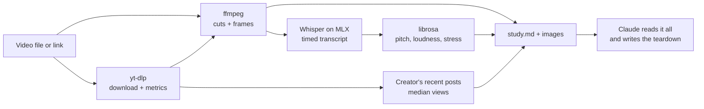

<div align="center">

# freeify

**Reverse-engineer any viral short. For free. On your own Mac.**

Drop a video or paste a TikTok, Instagram Reel or YouTube Shorts link into Claude Code.<br>
Get back the hook, the beat structure, the pacing, the voice energy, and the visuals — down to the outfits.


</div>

---

## Why

Video teardown tools usually rent you a cloud scraper and a transcription API, and bill per video. freeify does the same job with free, local tools: yt-dlp for metrics, Whisper on your Mac's GPU for the transcript, librosa for the voice, ffmpeg for the edit and frames. Claude reads the frames and writes the teardown.

No API keys and no credits beyond your Claude Code plan. The downloading, transcribing and measuring all happen locally. Claude only sees what it reads during your session: the frames, the transcript and the numbers.

## What you get

Paste a link or a file path and ask Claude to study it. You get a teardown with:

| Section | What's in it |
|---|---|
| **Snapshot** | Views, likes, comments, shares, followers, sound, posting date, and an **outlier score**: this video's views against the creator's median |
| **Transcript** | Full and timed, with the hook and call-to-action called out |
| **Hook** | The verbal, visual and on-screen-text hook in the first 3 seconds, and whether all three point at the same curiosity gap |
| **Structure** | A beat-by-beat map with timestamps, the open loops and where each one closes |
| **Retention** | Words per minute, dead air, every cut, shot lengths, cuts per minute and where the pace shifts |
| **Voice** | Pitch range, loudness range, stressed words, per-line energy and pace, and whether music fights the voice, plus a chart |
| **Visuals** | Outfits and styling for each person, setting, lighting, framing, props, caption style and expressions, shot by shot |
| **Remix template** | A fill-in-the-blank script of the video's beats and three angles for your niche |

Give it several links at once and you also get a **pattern report**: which hooks, formats, lengths, voices and looks keep winning in that niche, and five ready-to-film ideas.

There's also a **virality check** for your own drafts. It compares an unposted video with what has actually worked on your account.

## Install

You need an Apple Silicon Mac and [Homebrew](https://brew.sh):

```bash
brew install ffmpeg node python
```

Then, in Claude Code:

```
/plugin marketplace add jakalwaz/freeify
/plugin install freeify@freeify
```

That's it. The first time you use it, Claude runs a one-time setup that puts everything in the plugin's own folder. The first transcription downloads the Whisper model (about 1.6 GB) once.

## Use

Just talk to Claude:

```
study this: ~/Downloads/clip.mp4
```

```
why did this go viral? https://www.tiktok.com/@creator/video/1234567890
```

```
break these down and tell me what the niche rewards:
https://www.instagram.com/reel/...
https://www.youtube.com/shorts/...
https://www.tiktok.com/@.../video/...
```

```
virality check my draft ~/Movies/draft.mov — my TikTok is @me
```

Each study is saved to its own folder: `study.md` plus `hook.jpg`, `shots.jpg`, `voice.png` and the individual frames.

## How it works



- **Metrics:** yt-dlp for TikTok, YouTube and single reels. Instagram profiles load in a logged-out headless browser, because that's the only free place their view counts appear.
- **Transcript:** Whisper large-v3-turbo through mlx-whisper, on your Mac's GPU. Low-confidence lines, often invented words over music, are flagged and left out of the stats.
- **Voice:** librosa pitch tracking and loudness, measured per word and per line.
- **Edit:** ffmpeg scene detection, one labeled frame per shot, and a contact sheet of the first 3 seconds.

## Project layout

| File | What it does |
|---|---|
| `.claude-plugin/plugin.json` | Plugin manifest: name, version, description |
| `.claude-plugin/marketplace.json` | Lets Claude Code install the plugin straight from this repo |
| `skills/study/SKILL.md` | Tells Claude how to run a study and write the teardown |
| `skills/virality-check/SKILL.md` | Tells Claude how to run the pre-post check on your own draft |
| `study.mjs` | The main pipeline: download, probe, cut detection, frames, transcript, voice, and the `study.md` report |
| `audio.py` | Local Whisper transcript plus voice measurements (pitch, loudness, stressed words) and the `voice.png` chart |
| `scrape.mjs` | Free scraping: yt-dlp for TikTok and YouTube, a headless browser for Instagram profiles |
| `virality-check.mjs` | Scores an unposted video against your account's recent posts |
| `paths.mjs` | Where freeify keeps its environment, studies and cache |
| `setup.sh` | One-time install of Python packages, yt-dlp and the headless browser |
| `requirements.txt` | Python packages the setup installs |
| `virality-check.test.mjs` | Tests for the scraping parsers, shot splitting, speech stats and scoring (`npm test`) |

## Without Claude

The measuring scripts also work on their own:

```bash
git clone https://github.com/jakalwaz/freeify && cd freeify
./setup.sh
node study.mjs ~/Downloads/clip.mp4              # writes ~/.freeify/studies/clip/
node virality-check.mjs draft.mp4 --tiktok yourhandle
```

## Good to know

- **Local files have no views or likes.** Use the posted link for metrics and the outlier score.
- **Instagram, logged out, shows only ~12 recent reels per profile**, without lengths or captions.
- **TikTok sometimes blocks profile listings for a while.** freeify retries, and the study still runs without the baseline.
- **Voice stats mix everyone who talks**, because speakers aren't separated. They're measurements, not mind reading.
- **Frames are stills**, so camera moves and transitions are inferred from neighbouring frames.
- **Platforms change.** If scraping breaks, run `./setup.sh` again to update yt-dlp.
- **Be a good citizen.** Scraping public pages can be against a platform's terms. Keep volume low and use it for your own research.

## License

[MIT](LICENSE)
